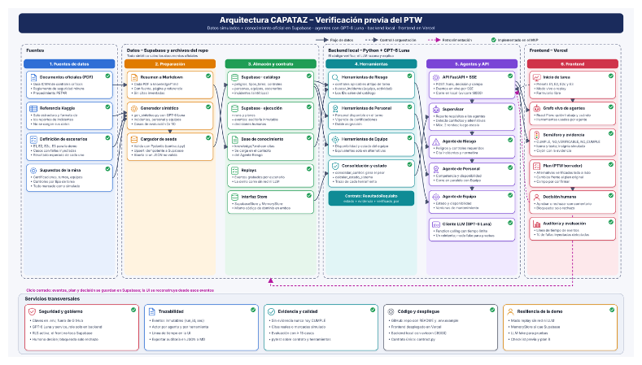

# Arquitectura de CAPATAZ

## Cómo leer el diagrama

- **Checks verdes = alcance planificado del MVP**, no funcionalidad terminada. El estado real de cada requisito se sigue en [`../requisitos/`](../requisitos/00-indice.md) (criterios de salida por fase).
- **LLM:** GPT-6 Luna vía OpenRouter (`OPENROUTER_API_KEY`, `LLM_MODEL`); solo el backend lo llama (RT-09).
- **Ciclo cerrado:** la flecha de retroalimentación del frontend al almacén **pasa por la API**: Frontend → FastAPI → `Store` → Supabase. El frontend nunca habla con Supabase (anexo de Supabase, regla 1).
- **Despliegue:** el frontend en Vercel es una vitrina pública. La demo corre con frontend y backend locales (RF-F3-45), así funciona sin Internet en modo replay (RT-08).
- **Incidentes:** el catálogo incluye incidentes simulados con el formato de la referencia de Kaggle, sin cargar sus datos (RF-F0-16); el Agente Riesgo los consulta con `buscar_incidentes` (RF-F1-19).
- **Generador sintético:** produce borradores que una persona revisa y versiona en `data/*.json`; no genera citas normativas ni el resultado esperado de la evaluación (RF-F0-17, RF-F3-20).

## Pendiente al regenerar la imagen

1. Cambiar la leyenda «Implementado en el MVP» por «Planificado en el MVP».
2. Dibujar la flecha de «ciclo cerrado» desde el frontend hacia la API, no directo al almacén.
3. Indicar «vía OpenRouter» en el cuadro «Cliente LLM (GPT-6 Luna)».
4. Rotular el bloque «Frontend – Vercel» como «Frontend – local en la demo · Vercel como vitrina».
